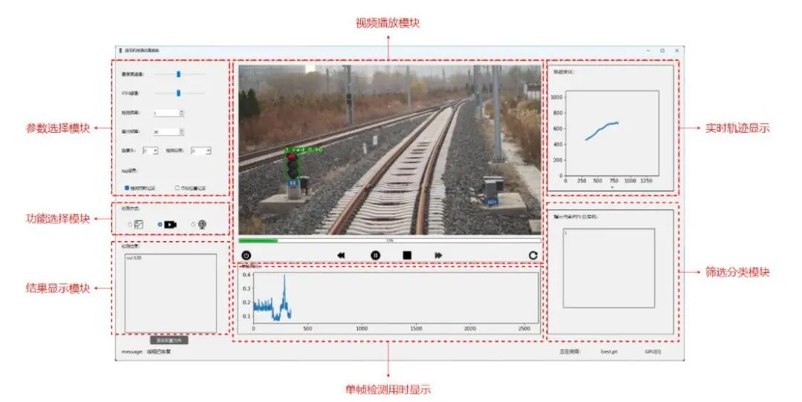
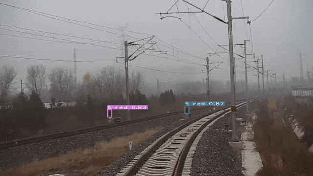

# Python-based automatic recognition and simulation system for railway signal machines, source code + trained model + GUI interface

## YOLOv5 Railway Signal Machinery Video Auto-Identification and Simulation System

**Railway Signal Machine Intelligent Recognition System Based on YOLOv5 Object Detection + DeepSort Object Tracking + PyQt5 Visualization Interface**

---

### Table of Contents

-

• Project Overview

-

• Algorithm principles

-

• Environmental requirements

-

• Installation steps

-

• Operating steps

-

• Important notes

-

• Folder structure

---

### Project Overview

This project is an intelligent auxiliary system aimed at railway operation safety scenarios. The core goal is to **real-time detect, track, and filter** the signals ahead of the train during its operation, and present the results to the driver through a PyQt5 visual interface for intuitive display, thereby alleviating driver visual fatigue, reducing misjudgment risks, and enhancing operational safety.

The system mainly has the following three major functions:

1.

1. **Image Detection**: Target detection of signal towers in a single railway scene image.

1.

2. **Video Detection**: Offline signal detection and tracking of railway operation video footage

1.

3. Real-time detection: Attaching a camera for real-time signal monitoring and tracking

The following signal categories are supported for detection:

|

Signal machine types

 ||

Detection category name

 ||

Note

 |

|

Red

 || `red` ||

Stop, no crossing of signals

 |
|

Green

 || `green` ||

Allow passing over this signal

 |
|

Single yellow

 || `s_yellow` ||

Slow down, or indicate to stop on the main line

 |
|

Double yellow

 || `d_yellow` ||

Instruct for sideline stop

 |
|

White moon

 || `white` ||

Guiding signal, or allowing trains to pass over the signal.

 |
|

Blue

 || `blue` ||

No trains are allowed to pass over this signal.

 |

---

### Algorithm Principles

#### 1. YOLOv5 Object Detection

YOLOv5 (You Only Look Once v5) is a single-stage object detection algorithm that transforms the object detection problem into a regression problem, predicting both the bounding box and class probability of the target in one forward propagation.

This system is based on the YOLOv5s (small) model and has made the following improvements for railway signal detection scenarios:

-

• **Mosaic9 Data Augmentation**: Expanding from the original Mosaic4 (combining 4 images) to a combination of 9 images, significantly increasing the diversity of backgrounds in training samples, enhancing the model's ability to perceive small targets.

-

• **Edge Extension for Copy-Paste Data Augmentation**: This technique involves extracting the target instance from the original image and pasting it onto another background image, while also appropriately expanding the edges of the target to enhance the model's feature learning capability for signal box targets.

-

• **Small Object Detection Layer**: On top of the existing three detection heads (P3/P4/P5), an additional high-resolution P2 detection head is added, specifically designed for capturing small target signal lights, significantly improving the detection rate of distant signal lights.

#### 2.DeepSort target tracking

DeepSort is a multi-target tracking algorithm based on the "Tracking-by-Detection" paradigm. Its workflow is as follows:

1.

1. **Kalman Filter Prediction**: Utilize the Kalman filter to predict the next frame's position of each target, narrowing down the matching search range.

1.

2. **Feature Extraction**: Extract appearance feature vectors for each target using a deep convolutional network (ReID model).

1.

3. **Cascade Matching**: Combines Mahalanobis distance (motion information) and cosine distance (appearance features) for Hungarian algorithm matching.

1.

4. **Trajectory Management**: Establish new trajectories for unmatched targets, and delete existing trajectories that have disappeared.

In this project, DeepSort is used for real-time tracking of signals detected by YOLOv5, acquiring trajectory information of the same signal in consecutive frames, providing a data foundation for subsequent multi-signal selection.

#### 3. MultiSignalFilter

In actual railway scenarios, there may be multiple signal towers within the driver's field of view simultaneously. However, only the signal tower that indicates the train's movement is considered an effective target. The MultiSignalFilter module filters out multiple candidate signal towers based on the motion characteristics of their continuous trajectories, and outputs the results of valid signal tower detection related to the train's movement.

---

### Environmental Requirements

|

Environment

 ||

Version requirements

 |

|

Operating system

 ||

Windows 10/11

 |
|

Python

 ||

3.8 (recommended)

 |
|

PyTorch

 ||

≥ 1.12.0

 |
|

CUDA

 ||

11.x (recommended, needs to match PyTorch version)

 |
|

cuDNN

 ||

Corresponds to CUDA version

 |
|

Graphics card

 ||

NVIDIA GPU (memory >= 4GB, recommended to have more than 6GB)

 |

>

**Note**: CPU mode can be used but with slower speed, it is strongly recommended to use GPU environment.

---

### Installation Steps

#### Step 1: Install CUDA and cuDNN

Go to the NVIDIA official website and download and install the CUDA Toolkit that matches the graphics card driver, and configure the corresponding version of cuDNN.

#### Step 2: Install PyTorch

Select the corresponding command from PyTorch's history page based on CUDA version, such as CUDA 11.6:

```
pip install torch==1.12.0+cu116 torchvision==0.13.0+cu116 --extra-index-url https://download.pytorch.org/whl/cu116
```

#### Third Step: Clone the Project and Install Dependencies

```
# Clone Project Code
git clone <your-repo-url>
cd yolov5-5.0
# Installing Dependencies
pip install -r requirements.txt
```

Main Dependency Explanation:

-

• `torch / torchvision` : deep learning framework

-

• `opencv-python`: Image Processing

-

• `numpy / scipy / matplotlib`: Numerical Computation and Visualization

-

• PyQt5: Graphical User Interface framework

-

• `PyYAML`: Configuration File Parsing

-

• `tensorboard`: Visualization of training logs

-

• `tqdm`: progress bar display

-

• `openpyxl / pandas`: Data export processing

-

• `easydict / Cython` : DeepSort dependency

---

### Running Steps

#### Starting the graphical interface (recommended)

```
python mainwindow.py
```

After startup, the system main interface will be entered, which includes the following functional areas:

-

• **Parameter Setting Module**: Adjust parameters such as detection confidence, IoU threshold, inference image size, etc.

-

• **Feature Selection Module**: Switch between image detection, video detection, and real-time detection modes.

-

• **Results Display Module**: Displays the results, detection categories, and confidence levels.

-

• **Video Playback Module**: Real-time playback of detection video streams

-

• **Trajectory Display Module**: Dynamically displays the real-time trajectory tracked by DeepSort.

-

• **Time Usage Display Module**: Displays the time taken for a single frame detection.



Insert image description here.

#### Command-line reasoning (optional)

```
# Detection of single images
python detect.py --source data/images/bus.jpg --weights weights/train_signal500.pt --conf 0.4
# Video Detection
python detect.py --source path/to/video.mp4 --weights weights/train_signal500.pt --conf 0.4
# Real-time detection using a camera
python detect.py --source 0 --weights weights/train_signal500.pt --conf 0.4
```



Insert image description here.

#### Model Training (optional)

```
python train.py --data data/train_signal.yaml --cfg models/yolov5s_improved.yaml --weights weights/yolov5s.pt --epochs 100 --batch-size 16 --img-size 640
```

---

### Notes

1.

1. **GPU Memory Insufficient**: If the error "CUDA out of memory" occurs during training, please appropriately reduce the `--batch-size` or `--img-size` parameters.

1.

2. **PyTorch and CUDA Version Compatibility**: Please ensure that the PyTorch version is compatible with the CUDA version, otherwise, GPU acceleration will not be effective.

1.

3. **Weight File**: Pre-trained weights are provided in the `weights/` directory, among which `train_signal500.pt` is the optimal model (mAP@0.5:0.95 = 0.8204), and it is recommended to use first.

1.

4. **Camera Permissions**: When using real-time detection features, ensure that the camera has been granted access permissions by the system.

1.

5. **Video Format**: Video detection supports common formats (`.mp4`, `.avi`, `.mov` etc.), it is recommended to use MP4 files with H.264 encoding.

1.

6. **Do not include Chinese in the path**: Some third-party libraries do not support Chinese paths well, it is recommended to place the project under a pure English path.

1.

7. **Dataset Format**: When customizing training, the dataset must be labeled in YOLO format (`class x_center y_center width height` normalized to 0-1).

1.

8. **DeepSort Weights**: The ReID weights file for DeepSort is located at `deep_sort_pytorch/deep_sort/deep/checkpoint/ckpt.t7`, please ensure that this file exists.

---

### Folder Structure

```
yolov5-5.0/
├── data/ # Data configuration directory
│   ├── images/                     # Example image（bus.jpg、zidane.jpg）
├── scripts/ # Dataset Download Scripts (COCO, VOC, Argoverse)
├── coco.yaml # COCO dataset configuration
├── voc.yaml # VOC dataset configuration
├── road_signal.yaml # Road Signal Machine Data Set Configuration
├── train_signal.yaml # Railway Signal Machine Data Set Configuration
├── train_signal500.yaml # Railway Signal Machine (500 images) dataset configuration
├── hyp.scratch.yaml # configuration for hyperparameters training from scratch
└── hyp.finetune.yaml # Fine-tuning training hyperparameters configuration
│
├── models/ # Model definition directory
│   ├── hub/                        # Various model variant configurations（YOLOv3/5/6Series）
│   ├── common.py                   # Universal module (convolution, residual blocks, etc. Basic component definitions)）
├── yolo.py # YOLO model construction logic
├── export.py # Model export tool (ONNX, TorchScript, etc.)
├── experimental.py # Experimental features (Model loading assistance)
├── yolov5s.yaml # Configuration of the YOLOv5s model structure
└── yolov5s_improved.yaml # YOLOv5s Improved Model Structure Configuration (including small object detection layer)
│
├── utils/ # Tool function directory
│   ├── aws/                        # AWS Cloud deployment script
├── google_app_engine/ # Google App Engine deployment configuration
├── wandb_logging/  # Weights & Biases Logging Integration
│   ├── datasets.py                 # Data Set Loading and Preprocessing
│   ├── general.py                  # Universal tool function（NMS、Coordinate conversion, etc.）
│   ├── loss.py                     # Loss function definition
├── metrics.py # Evaluation metric calculations (e.g., mAP)
├── plots.py # Visualization tool (drawing detection boxes, results, etc.)
├── torch_utils.py # PyTorch tool functions (device selection, model EMA, etc.)
├── autoanchor.py # Adaptive anchor box calculation
└── activations.py # Activation function definition
│
├── deep_sort_pytorch/ # DeepSort target tracking module
│   ├── configs/
│ └── deep_sort.yaml # DeepSort tracking parameter configuration
│   ├── deep_sort/
│   │   ├── deep/                   # ReID Feature Extraction Network
│   │   │   ├── checkpoint/
│ │ │ │ └── ckpt.t7 # ReID pre-trained weights
├── model.py # Define the ReID network structure
│ │ │ └── feature_extractor.py# Feature Extractor Encapsulation
│   │   ├── sort/                   # Sort Track core algorithms
├── kalman_filter.py # Kalman Filter
├── linear_assignment.py# Hungarian Algorithm
├── nn_matching.py # Nearest Neighbor Matching
│   │   │   ├── track.py            # Trajectory definition
│ │ │ └── tracker.py # Main logic of the tracker
└── deep_sort.py # DeepSort overall encapsulation
│   └── utils/                      # DeepSort Auxiliary tool
│
├── Datasets_Processing/ # Datasets Processing Tool
├── datasets_statistic.py  # Data set statistical analysis
├── reformat.py # Dataset format conversion
├── rename.py  # File batch renaming
└── SuperfluousFilesSearch.py # Superfluous Files Search
│
├── weights/  # Model weight directory
├── yolov5s.pt  # YOLOv5s pre-trained weights
├── coco128.pt # COCO128 training weights
├── road_signal.pt # Road Signal Machine Training Weights
├── train_signal.pt # Railway signal machine training weights
└── train_signal500.pt # Optimal Weights for Railway Signals (500 Images)
│
├── log/  # Directory for running logs
├── position_log.xlsx  # Signal machine position log
├── time_log.xlsx # Detection Time Log
└── position_log.png # Position Log Visualization
│
├── resource/                 # UI Resources Directory (Icons, background images, etc.)
├── UiMainwindow.py  # Main window UI code (generated from .ui file)
├── UiMainwindow.ui  # Main window Qt Designer file
├── mainwindow.py                   # Main program entry point (starting the graphical interface)）
├── model_load.py  # Model loading encapsulation
├── multi_signal_filter.py  # Multi-Signal Filter module
├── my_window_effect.py  # Window effect (such as frosted glass effect)
├── resource.qrc  # Qt resource description file
├── resource_rc.py  # Qt resource compiled Python file
├── signal.yaml  # Signal machine category configuration
├── detect.py  # Inference detection script
├── train.py  # Model training script
├── test.py  # Model Test/Evaluation Script
└── requirements.txt  # Project dependency list
```

---

**Model Weight Reference**

|

Model file

 ||

Training dataset

 ||

Input dimensions

 || mAP@0.5

:0.95

 |

| `coco128.pt` ||

COCO128

 ||

640×640

 ||

0.7996

 |
| `road_signal.pt` ||

road_signal

 ||

640×640

 ||

0.7516

 |
| `train_signal.pt` ||

train_signal

 ||

640×640

 ||

0.7805

 |
| `train_signal500.pt` ||

train_signal500

 ||

640×640

 || **0.8204** |


## Payment

Here is a pay link on Stripe ( https://buy.stripe.com/3cs8yP7sY87d0vu9AB ). Please contact me lonlonago@foxmail.com after funding $89, and I will send you a complete data files , thank you!


